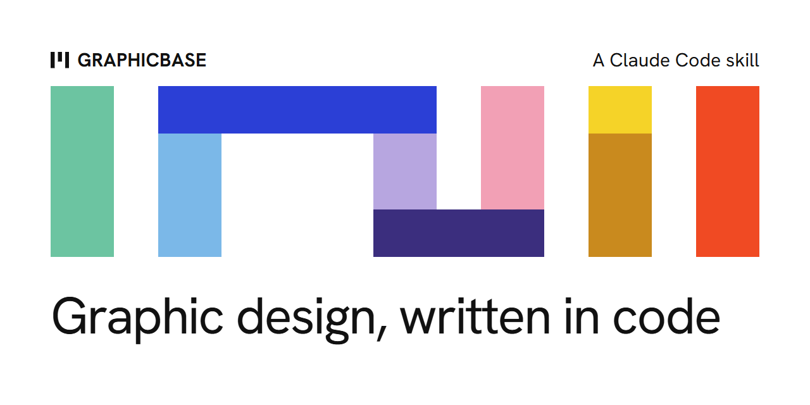
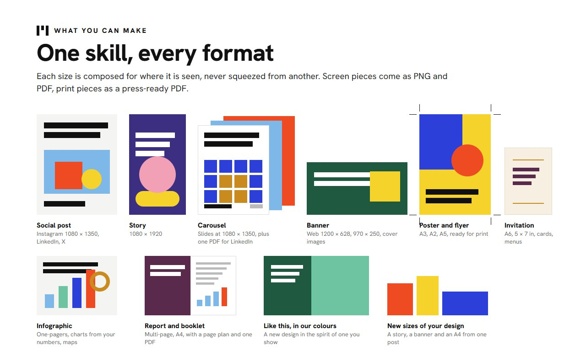
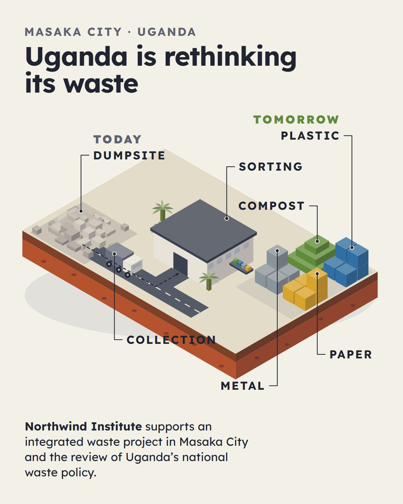
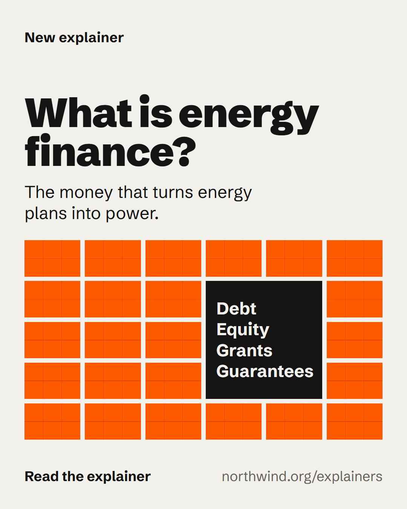
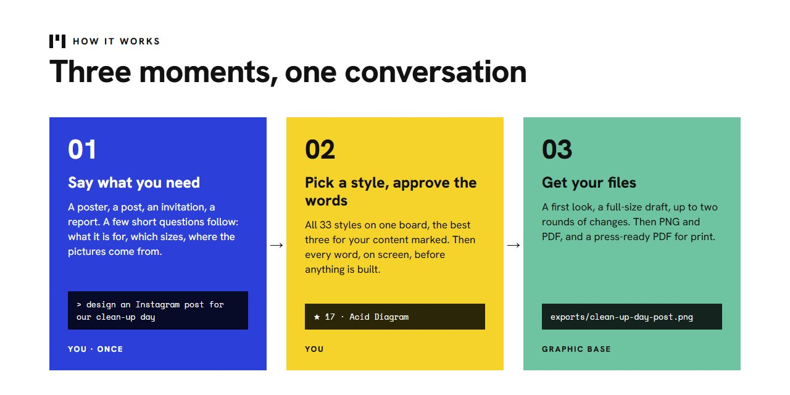
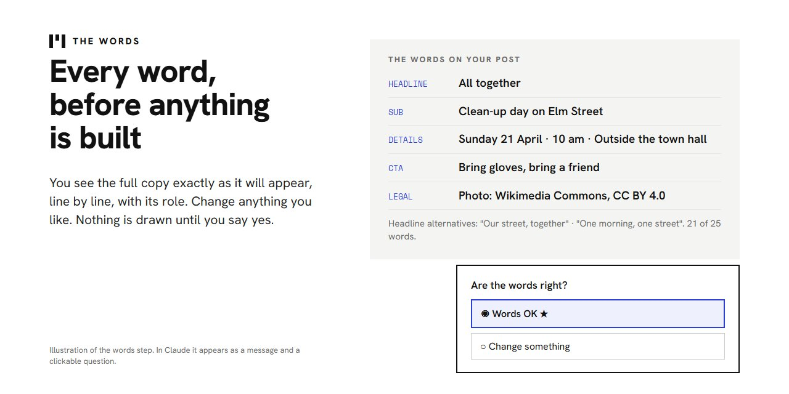
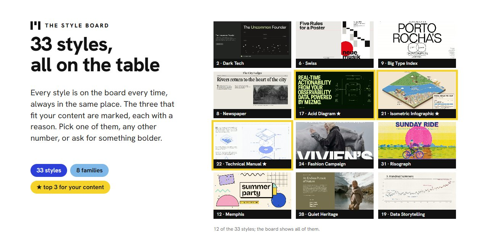
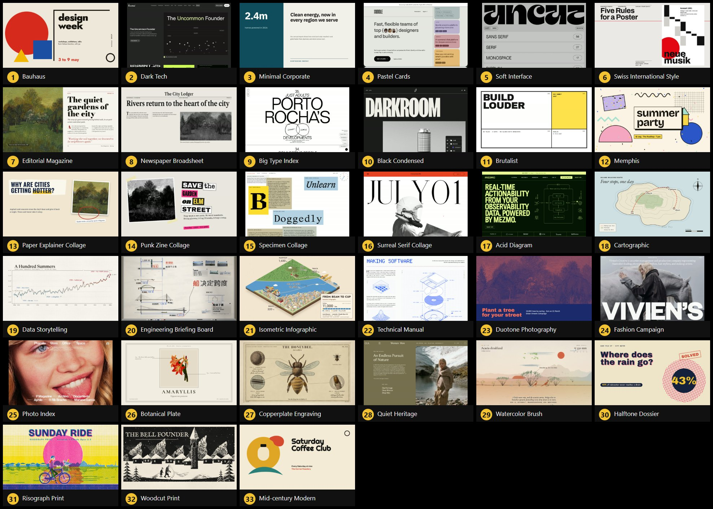
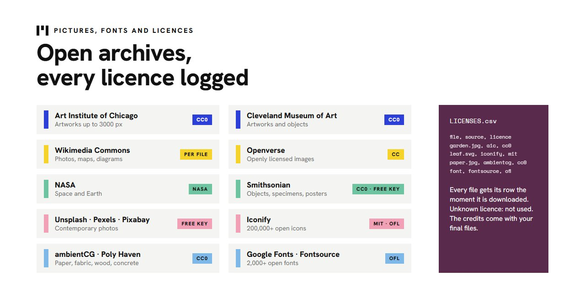
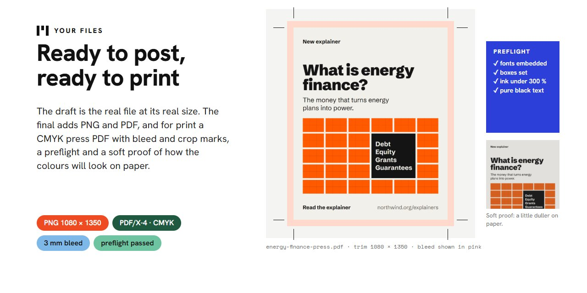

<!--
Search keywords (kept here so GitHub search, Google and AI assistants can find the project):
graphic base is a free, open source Claude Code skill for graphic design written in code.
claude code skill, claude skill, ai graphic design, poster design, social media post design, instagram post,
linkedin carousel, banner design, flyer design, invitation design, infographic maker, report design,
one-pager, print-ready pdf, pdf/x-4, cmyk, bleed and crop marks, style board, moodboard, design system,
html to png, html to pdf, open licence images, google fonts, open source design tool.
-->

<p align="center">
  
</p>

<h1 align="center">graphic base</h1>

<p align="center">
  <b>Graphic design that doesn't look AI.</b>
</p>

<p align="center">
  Graphic Base turns Claude Code into your design partner. Tell it what you need, a social post, a carousel,<br/>
  a poster, an invitation, a report, and it works with you the way a good designer would. It asks what the<br/>
  piece is for, shows you styles to choose from, writes the words and lets you change every one,<br/>
  then builds the design and checks it before you see it. Your taste decides. It does the rest.
</p>

<p align="center">
  Already have a brand? Bring your logo, colours and fonts and get more of it: new sizes, new products,<br/>
  the next campaign, all in your house style.
</p>

<p align="center">
  
  
  
  <a href="LICENSE"></a>
</p>

<p align="center">
  <a href="#install-in-one-minute"></a>
  &nbsp;
  <a href="#the-33-styles"></a>
</p>

<p align="center">
  <sub>Free. Open source under MIT. No account, no paid services, no AI-generated images unless you ask. Your files stay on your computer.</sub>
</p>

---

## Contents

- [Why graphic base](#why-graphic-base)
- [It doesn't look like AI](#it-doesnt-look-like-ai)
- [Install in one minute](#install-in-one-minute)
- [Your first design](#your-first-design)
- [What you can make](#what-you-can-make)
- [Made with graphic base](#made-with-graphic-base)
- [How a design comes together](#how-a-design-comes-together)
- [The words come first](#the-words-come-first)
- [The 33 styles](#the-33-styles)
- [Quick or Studio](#quick-or-studio)
- [Pictures, fonts and licences](#pictures-fonts-and-licences)
- [Ready for the printer](#ready-for-the-printer)
- [What graphic base refuses to do](#what-graphic-base-refuses-to-do)
- [Frequently asked questions](#frequently-asked-questions)
- [For developers](#for-developers)
- [Thanks and licence](#thanks-and-licence)

---

## Why graphic base

graphic base is a skill for Claude Code that designs graphics with you: social posts, carousels, banners, posters, invitations, infographics and reports. You talk to it in plain words. It asks what the piece is for, shows you styles to pick from, writes the words for your OK, and builds the design in code. You get finished PNG and PDF files, and a press-ready PDF when it goes to print.

**It's for you if:**

- **You want good-looking graphics without a designer.** Pick a style, approve the words, and get a piece that looks made by hand, not by a template.
- **You already have a brand and need more of it.** Bring your logo, colours and fonts, and get variations: the same campaign in new sizes, a new product in the house style, a story and a banner from one post.
- **You make the same kind of piece again and again.** Save a design's look as a format, and the next event poster or monthly report starts from it.
- **You need things printed.** It sets up bleed, crop marks and CMYK for you, and checks the file before it goes to the printer.
- **You're tired of graphics that look AI-made.** No generated images, no purple gradients, no words that sound like an ad (see [below](#it-doesnt-look-like-ai)).

It works the way a good designer does: a plan first, a first look before the rest, and checks for the things that are easy to miss (text too small to read on a phone, colours that fail contrast, a word too close to the edge).

### How it compares

| | graphic base | A plain AI chat | Template tools |
|---|---|---|---|
| Where the look comes from | 33 real styles, chosen by you, fitted to your content | Whatever the model reaches for first | The template you picked, shared with millions |
| The words | Written for your piece, every word shown for your OK before the build | Generic, often salesy | Yours to write |
| Checks | Readable size where it is seen, contrast, safe edges, fonts with every letter | None | Some |
| Print | Press-ready CMYK PDF/X-4 with bleed, crop marks and a preflight | No | Often a paid extra |
| Images | Open archives or drawn in code, each with its licence recorded | Generated | Stock library |
| Looks AI-made? | No: AI habits are flagged on every check | Often | Sometimes |
| Price | Free, MIT | Your AI plan | Free tier or subscription |

---

## It doesn't look like AI

Most AI design tools land on the same look: a purple gradient, glass cards, a generated picture, a centred headline that sounds like an ad. graphic base is built to stay away from it.

- **No generated images.** Pictures come from open archives (museums, Wikimedia, NASA and more) or are drawn in code. AI images only if you ask for them.
- **A real style, chosen by you.** The look comes from one of 33 styles you pick on the board, not from whatever the model reaches for first.
- **It flags the AI habits.** The fonts, palettes and layouts every generated design reaches for (Inter by habit, purple-to-blue gradients, glass panels, floating cards, emoji bullets, everything centred) are flagged on every check and need a real reason to stay.
- **Words that sound written, not generated.** Every line is checked for the tells: no long dashes, no "not X but Y", no inflated sales lines. And you approve every word before anything is built.
- **Made for this piece only.** Each first look is checked against one question: could this belong to another brand? If it could, it is redone.

---

## Install in one minute

graphic base is a skill: a folder Claude Code reads. Put it in your skills folder and it is ready.

<table>
  <tr>
    <th align="left">You need</th>
    <th align="left">How to get it</th>
  </tr>
  <tr>
    <td><b>Claude Code</b></td>
    <td>The terminal app, the desktop app or the IDE extension (<a href="https://claude.com/claude-code">claude.com/claude-code</a>)</td>
  </tr>
  <tr>
    <td><b>Node.js 22+, Python 3, Chrome or Edge</b></td>
    <td>Free. If one is missing, graphic base offers to install it for you on the first run.</td>
  </tr>
  <tr>
    <td><b>Ghostscript</b> (only for print files)</td>
    <td>Free. Offered the first time a design has a print size.</td>
  </tr>
</table>

Then one line in a terminal:

```bash
git clone https://github.com/omerkavuk/graphic-base ~/.claude/skills/graphic-base
```

No git? Download the ZIP from the green **Code** button, unzip it, and put the `graphic-base` folder in `~/.claude/skills/` (on Windows: `C:\Users\<you>\.claude\skills\`). Start a new Claude Code session and you're done.

---

## Your first design

1. Open Claude Code in any folder and say what you need: *"Design an Instagram post announcing our clean-up day on 21 April."*
2. Answer a few short questions: Quick or Studio, what the post is for, where the pictures come from.
3. Look at the style board and pick a style (the three that suit your post are marked).
4. Read the words it wrote. Change any of them.
5. Approve the plan and the first look. Then the draft, a round of changes if you want them, and your PNG lands in a `Designs` folder.

Say **"graphic base"** on its own to see everything it can do.

---

## What you can make

<p align="center"></p>

- Social media posts, stories, carousels and banners
- Posters, flyers and invitations, for screen or ready for the printer
- Infographics and one-page explainers
- Reports and other multi-page documents, with charts from your numbers
- A new design in the spirit of one you like ("like this, but in our colours")
- New sizes of a design you already have (a story and a banner from one post)

---

## Made with graphic base

<p align="center">
  
  &nbsp;
  
</p>

---

## How a design comes together

<p align="center"></p>

**1. A few questions.** What is it for, what sizes, where do the pictures come from. It never asks what you already told it.

**2. The style board.** You see all 33 styles at once, each as a picture, with the three that suit your content marked. A report about money gets calm, clear picks; a jazz night gets bold, colourful ones. Pick any style on the board, or ask for something bolder.

**3. The words.** Every word that will be on your design, shown to you before anything is built. You change what you like.

**4. The plan.** Colours, fonts, layout and what your eye should see first, in one short card.

**5. A first look.** One size, finished, for your OK. Then the rest.

**6. The draft.** Every size at full quality. You can ask for changes twice.

**7. Your files.** PNG and PDF. For print, a PDF your printer can use straight away.

---

## The words come first

<p align="center"></p>

Most design tools hand you a layout and leave the words for later. graphic base does it the other way round. Before a single shape is drawn, you get every word that will be on the piece, exactly as it will appear, with its role (headline, details, call to action, credits), two or three headline alternatives and a word count. Change anything. Nothing is built until you say the words are right.

---

## The 33 styles

<p align="center"></p>

Every style is on the board every time, always in the same place, so number 17 is always Acid Diagram. Your design takes a style's colours, type and spacing, never its layout.

<details>
<summary><b>See all 33 styles on one board</b></summary>
<p align="center"></p>
</details>

| Family | Styles |
|---|---|
| **Clean and modern** | 1 Bauhaus · 2 Dark Tech · 3 Minimal Corporate · 4 Pastel Cards · 5 Soft Interface · 6 Swiss International Style |
| **Editorial** | 7 Editorial Magazine · 8 Newspaper Broadsheet |
| **Expressive** | 9 Big Type Index · 10 Black Condensed · 11 Brutalist · 12 Memphis · 13 Paper Explainer Collage · 14 Punk Zine Collage · 15 Specimen Collage · 16 Surreal Serif Collage |
| **Information** | 17 Acid Diagram · 18 Cartographic · 19 Data Storytelling · 20 Engineering Briefing Board · 21 Isometric Infographic · 22 Technical Manual |
| **Photo-led** | 23 Duotone Photography · 24 Fashion Campaign · 25 Photo Index |
| **Heritage** | 26 Botanical Plate · 27 Copperplate Engraving · 28 Quiet Heritage · 29 Watercolor Brush |
| **Print craft** | 30 Halftone Dossier · 31 Risograph Print · 32 Woodcut Print |
| **Retro** | 33 Mid-century Modern |

---

## Quick or Studio

- **Quick:** one piece in up to about four sizes, done today. About four OKs from you: the style, the words, the plan, the first look.
- **Studio:** reports, booklets, carousels and campaigns. A page plan, the full copy, a style frame, a layout sheet of every page, then the draft. Your OK at every step, or straight to the draft if you prefer.

---

## Pictures, fonts and licences

<p align="center"></p>

Photos, artworks, icons and textures come from free, open archives (museums, Wikimedia, Openverse, NASA and more). Every file is logged with its licence the moment it is downloaded, and the credits you need come with your final files. Fonts are open licence, picked for your piece, and checked for every letter your language uses. Talk to it in any language; it answers in yours.

---

## Ready for the printer

<p align="center"></p>

For anything printed, graphic base sets the trim size and bleed from the start and delivers:

- a press PDF (CMYK, PDF/X-4) with crop marks and trim boxes;
- a preflight report of the fonts, colours, ink coverage and boxes;
- a soft proof showing how the colours will look on paper.

---

## What graphic base refuses to do

- It never generates AI images unless you ask for them.
- It never uses paid services, API keys or large downloads without your OK, and never shows a key in the chat.
- It never builds before you have seen and approved the words and the plan.
- It never copies a reference's layout: a draft that comes too close to it is held back.
- There is no graphic base server and no account. Your designs live in a folder on your computer.

---

## Frequently asked questions

**Do I need to know how to code?** No. You talk; it writes the code. You never have to open it.

**Can I use my own logo, fonts and colours?** Yes. Drop them in the design folder and say so. Your logo is placed as given, never redrawn.

**Can it write in my language?** Yes, the words and the conversation. It checks that the fonts have every letter you need.

**Can I edit the design later?** Yes. Each design is a folder with one HTML file and a `STATE.md` that remembers where you left off. Open Claude Code there and say "continue from STATE.md".

**Is it really free?** Yes. The skill is MIT licensed, and it only uses free tools and open sources. You need your own Claude Code access.

---

## For developers

```bash
python -m unittest discover -s tests -v
```

Node and Chrome are needed for the render tests. The method lives in `SKILL.md` and `references/`, the tools in `scripts/`, the styles in `styles/` (one recipe and one picture each).

---

## Thanks and licence

graphic base grew out of [cinecode](https://github.com/sarpstar/cinecode) by Sarp Yıldız, a skill for making films with code. Its way of working, and several of its tools, made this possible. Some style recipes come from the lemo-opuscar library by LemoLab. Some style pictures show public websites found through [httpster](https://httpster.net); they belong to their makers and are shown only for their style (see `styles/posters/CREDITS.md`).

Free to use under the MIT licence (see `LICENSE`).
